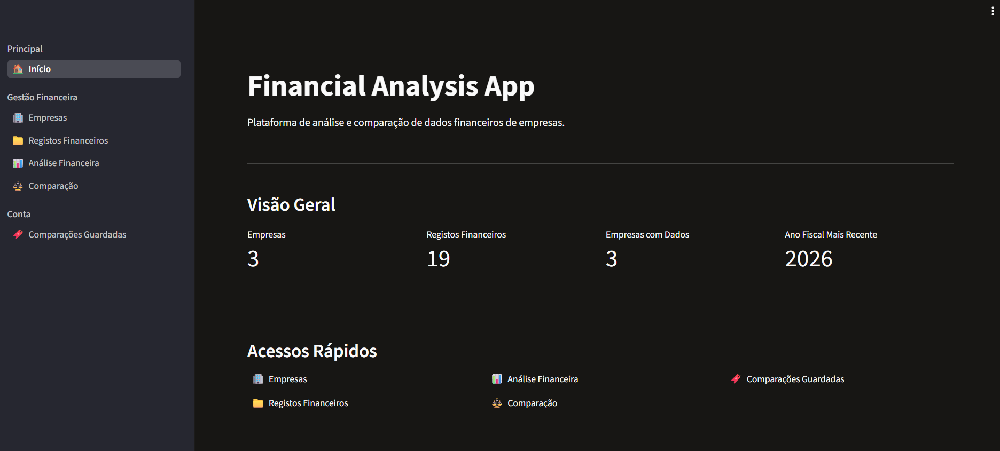
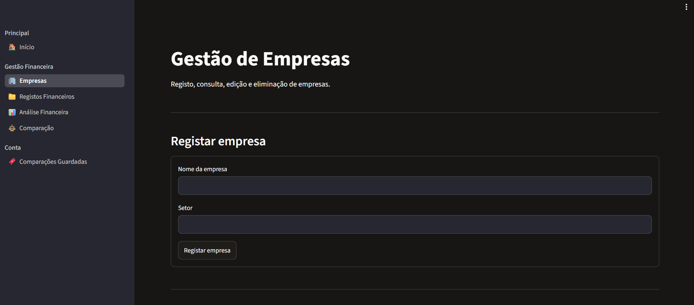
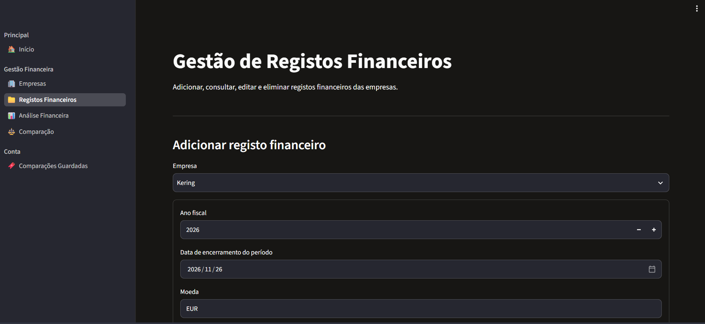
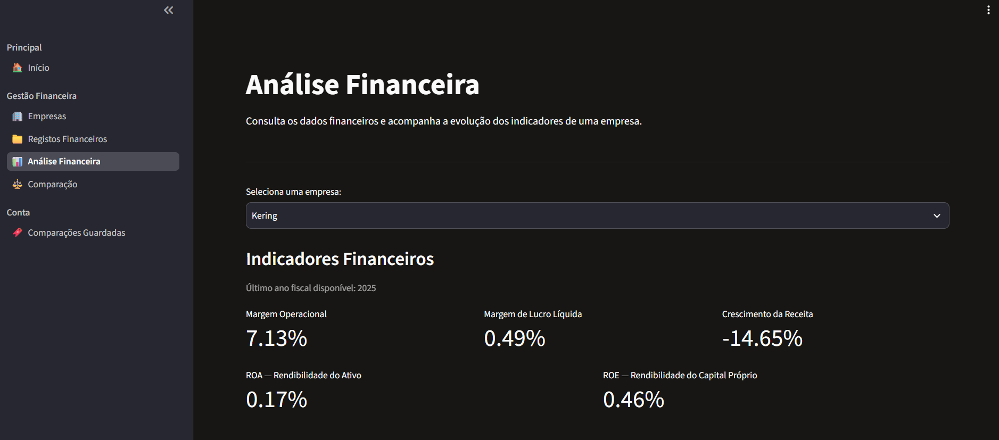
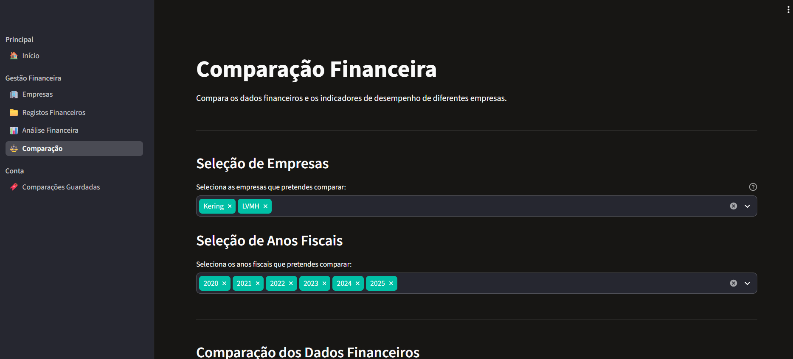
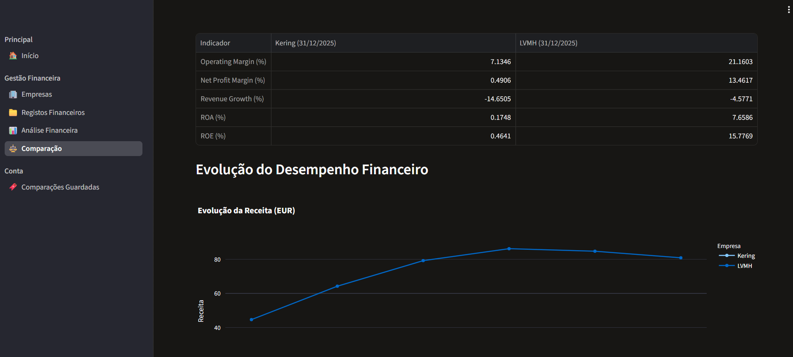
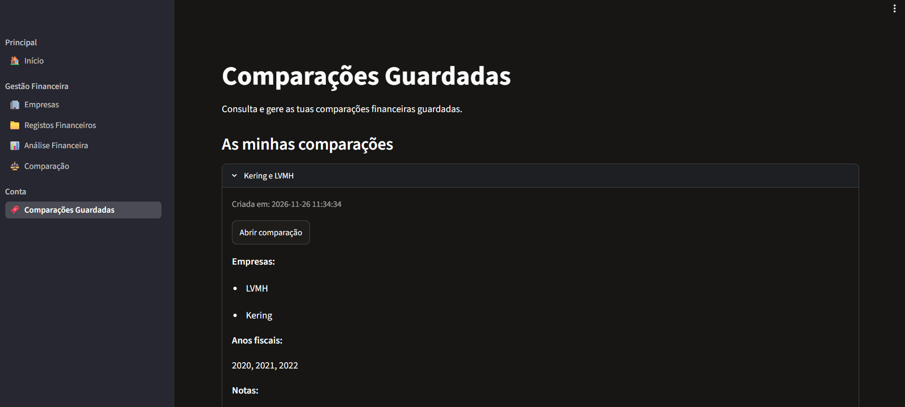
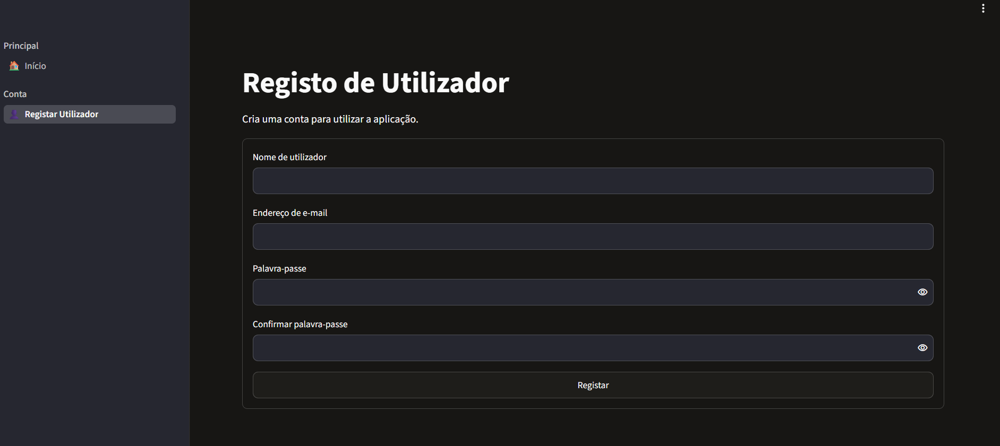
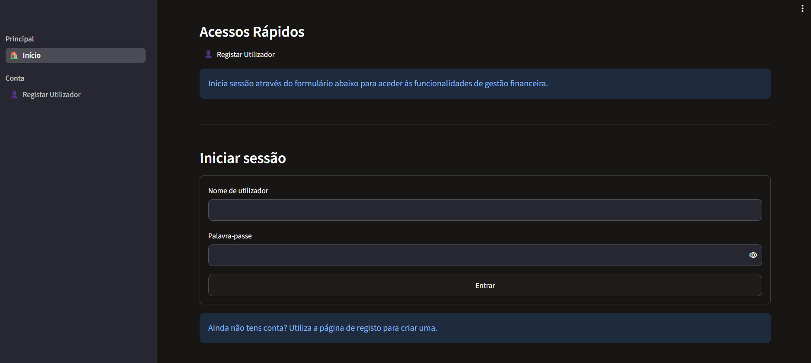

# 📊 Aplicação de Análise Financeira

## 📌 1. Visão Geral

A Aplicação de Análise Financeira é uma aplicação web destinada a centralizar e analisar dados financeiros públicos de empresas do setor de artigos de luxo.

O projeto pretende facilitar a consulta, interpretação e comparação de informação financeira, através de indicadores, tabelas e representações gráficas.

## 🎯 2. Objetivos

- Centralizar dados financeiros provenientes de fontes públicas.
- Facilitar a consulta e análise da informação financeira.
- Calcular indicadores financeiros relevantes.
- Representar graficamente a evolução dos resultados.
- Comparar o desempenho financeiro entre empresas e exercícios fiscais.

## ⚙️ 3. Funcionalidades

### ✅ Implementadas

- Registo e gestão de empresas.
- Consulta e listagem de empresas.
- Edição e eliminação de empresas, respeitando as regras de integridade da base de dados.
- Validação dos dados introduzidos através da interface.
- Registo e autenticação de utilizadores.
- Gestão de perfis de utilizador, com distinção entre administradores e utilizadores normais.
- Consulta e gestão de registos financeiros.
- Importação de dados financeiros a partir de ficheiros Excel através do módulo `import_financial_data.py`.
- Análise financeira individual por empresa e exercício fiscal.
- Cálculo de indicadores financeiros:
    - Margem Operacional (Operating Margin);
    - Margem de Lucro Líquida (Net Profit Margin);
    - Taxa de Crescimento da Receita (Revenue Growth);
    - Rendibilidade do Ativo (ROA);
    - Rendibilidade do Capital Próprio (ROE).
- Apresentação de dados financeiros através de tabelas.
- Representação gráfica da evolução dos indicadores financeiros.
- Comparação dos indicadores financeiros entre empresas e exercícios fiscais.
- Guardar, consultar e eliminar comparações financeiras.
- Associação das comparações guardadas ao respetivo utilizador.
- Testes automatizados das principais funcionalidades.

### 📋 Melhorias Futuras

- Melhorias na apresentação e validação dos resultados comparativos.
- Possibilidade de alargar a aplicação a outras empresas e setores de atividade.
- Eventual suporte para outras fontes e formatos de importação de dados.

## 🖥️ 4. Demonstração da Aplicação

### 4.1. Página Inicial

A página inicial apresenta uma visão geral da aplicação e permite aceder às principais funcionalidades.



### 4.2. Gestão de Empresas

Permite consultar, adicionar, editar e eliminar empresas.



### 4.3. Registos Financeiros

Permite consultar e gerir os registos financeiros das empresas.



### 4.4. Análise Financeira

Apresenta os indicadores financeiros de uma empresa e a respetiva evolução ao longo dos exercícios fiscais.



### 4.5. Comparação Financeira

Permite comparar os indicadores financeiros de diferentes empresas e exercícios fiscais.





### 4.6. Comparações Guardadas

Permite consultar e eliminar comparações previamente guardadas pelo utilizador autenticado.



### 4.7. Registo de Utilizadores

A aplicação disponibiliza uma funcionalidade de registo para criação de novas contas de utilizador.



### 4.8. Autenticação

A página de autenticação permite aos utilizadores aceder à aplicação através das suas credenciais.



## 🏢 4. Âmbito do Projeto

A aplicação foi inicialmente desenvolvida com o foco em três empresas do setor de artigos de luxo:
- LVMH
- Kering
- Richemont

Estas empresas constituem o conjunto principal de dados utilizado na análise e comparação fnanceira.

A base de dados inclui também a Prada, registada para efeitos de testes e validação de funcionalidades, sem registos financeiros associados.

O projeto foi concebido para permitir a inclusão futura de outras empresas e setores de atividade.

## 🛠️ 5. Tecnologias

- **Linguagem de Programação:** Python
- **Interface Web:** Streamlit
- **Análise e manipulação de dados:** Pandas
- **Visualização de dados:** Plotly
- **Base de Dados:** SQLite
- **Importação e leitura de ficheiros Excel:** OpenPyXL
- **Hashing seguro de palavra-passe:** Argon2 (`argon2-cffi`)
- **Testes automatizados:** Pytest
- **Controlo de versões:** Git e GitHub

As dependências Python econtram-se identificadas no ficheiro `requirements.txt`.

## 📂 6. Estrutura do Projeto

```
financial-analysis-app/
├── .streamlit/
│   └── config.toml
├── data/
│   └── processed/
│       └── financial-data.xlsx
├── docs/
│   ├── database/
│   ├── diagrams/
│   ├── images/
│   ├── learning-notes/
│   ├── planning/
│   └── reports/
├── src/
│   ├── pages/
│   │   ├── 1_Empresas.py
│   │   ├── 2_Registos_Financeiros.py
│   │   ├── 3_Analise_Financeira.py
│   │   ├── 4_Comparacao.py
│   │   ├── 5_Registo.py
│   │   └── 6_Comparacoes_Guardadas.py
│   ├── __init__.py
│   ├── app.py
│   ├── app_home.py
│   ├── companies.py
│   ├── database.py
│   ├── financial_indicators.py
│   ├── financial_records.py
│   ├── import_financial_data.py
│   ├── saved_comparisons.py
│   └── users.py
├── tests/
│   ├── test_app_home.py
│   ├── test_companies.py
│   ├── test_database.py
│   ├── test_financial_analysis.py
│   ├── test_financial_indicators.py
│   ├── test_financial_records.py
│   ├── test_import_financial_data.py
│   ├── test_saved_comparisons.py
│   └── test_users.py
├── README.md
├── requirements.txt
└── .gitignore
```
**Descrição das pastas e ficheiros principais**

- data/ — ficheiros com os dados financeiros utilizados no projeto.
- docs/ — documentação técnica, diagramas, notas de aprendizagem, planeamento e relatórios.
- src/ — código-fonte e lógica da aplicação.
- src/pages/ — páginas da interface desenvolvida em Streamlit.
- tests/ — testes automatizados dos módulos e funcionalidades da aplicação.
- .streamlit/ — configuração da interface Streamlit.
- requirements.txt — dependências Python do projeto.
- README.md — documentação principal do repositório.
- .gitignore — ficheiros e pastas excluídos do controlo de versões.

## 🚀 7. Instalação e Execução

**Pré-requisitos**
- Python 3.12 ou superior.
- Git.

### 7.1. Clonar o repositório

```powershell
git clone https://github.com/lidiapcarvalho/financial-analysis-app.git
```

Entrar na pasta do projeto:

```powershell
cd financial-analysis-app
```

### 7.2. Criar o ambiente virtual

```powershell
python -m venv .venv
```

Ativar o ambiente virtual no Windows (PowerShell):

```powershell
.venv\Scripts\Activate.ps1
```

### 7.3. Instalar as dependências

```powershell
python -m pip install -r requirements.txt
```

### 7.4. Executar a aplicação

```powershell
python -m streamlit run src/app.py
```

Após a execução, a aplicação ficará disponível no endereço local apresentado pelo Streamlit no terminal, normalmente `http://localhost:8501`.

## 🧪 8. Testes

O projeto utiliza **Pytest** para a execução de testes automatizados, permitindo verificar o funcionamento dos módulos e das principais funcionalidades da aplicação.

Para executar todos os testes, utilizar o seguinte comando na pasta principal do projeto:

```powershell
python -m pytest
```

## 🔀 9. Controlo de Versões

O projeto utiliza **Git e GitHub** para controlo de versões e organização do desenvolvimento.
- `main`: branch principal, destinada a manter a versão estável e integrada da aplicação.
- **Branches de funcionalidades:** utilizadas para desenvolver novas funcionalidades e correções de forma isolada.
- **Pull Requests:** utilizadas para rever e integrar as alterações na branch principal.

Este fluxo de trabalho permite organizar o desenvolvimento, acompanhar as alterações e manter o histórico de evolução do projeto.

## 📊 10. Estado do Projeto

**Fase atual:** desenvolvimento e consolidação das funcionalidades da aplicação.

A aplicação já inclui gestão de empresas e registos financeiros, autenticação e gestão de utilizadores, análise financeira individual, cálculo de indicadores, representação gráfica, comparação financeira entre empresas e gestão de comparações guardadas.

A base de dados utiliza SQLite e inclui mecanismos de migração para acompanhar a evolução da sua estrutura.

O projeto encontra-se numa fase de consolidação e preparação da documentação final, estando previstas futuras melhorias na interface, no suporte a outras fontes e formatos de importação de dados e na possibilidade de alargar a análise a outras empresas e setores de atividade.
